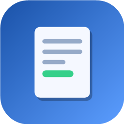

<p align="center">
  
</p>

<h1 align="center">Pente-Fino</h1>

<p align="center">
  Os contracheques da sua pasta, pesquisáveis por margem, banco, prazo e quitação.
</p>

<p align="center">
  <a href="https://github.com/AryCSO/pente-fino/releases/latest/download/Pente-Fino-Windows.exe">
    
  </a>
  &nbsp;
  <a href="https://github.com/AryCSO/pente-fino/releases/latest/download/Pente-Fino-macOS.dmg">
    
  </a>
</p>

<p align="center">
  <sub>Windows 10 ou mais novo · macOS 10.15 ou mais novo ·
  <a href="https://github.com/AryCSO/pente-fino/releases">todas as versões</a></sub>
</p>

---

## O que ele faz

O Pente-Fino lê os contracheques em PDF de uma pasta do seu computador e monta
uma lista pesquisável dos clientes. Em vez de abrir arquivo por arquivo, você
vê na hora **quem tem margem livre**, **quanto custa quitar** cada contrato,
**quem está perto de terminar de pagar** e **de qual banco** cada um já é — e,
no detalhe do cliente, calcula a proposta pronta para enviar.

Tudo roda no seu computador. Nenhum PDF, CPF ou valor sai da máquina.

## Instalar

**Windows** — abra o `Pente-Fino-Windows.exe` e siga o assistente. Não precisa
ser administrador. Se o Windows mostrar *"O Windows protegeu o computador"*,
clique em **Mais informações → Executar assim mesmo**.

**macOS** — abra o `Pente-Fino-macOS.dmg` e arraste o Pente-Fino para
**Aplicativos**. Na primeira vez, clique com o botão direito no app e escolha
**Abrir** (ou libere em **Ajustes do Sistema → Privacidade e Segurança**).

## Configurar a pasta dos contracheques

O app precisa saber **uma única pasta raiz** — a que guarda todos os
contracheques. Ele lê essa pasta e **todas as subpastas dentro dela**.

### 1. Organize a pasta raiz

Crie (ou escolha) uma pasta que reúna todos os PDFs. Qualquer uma destas
arrumações funciona, e dá para misturar:

```
Contracheques/                  ← pasta raiz: é esta que você escolhe no app
├── Clientes/
│   ├── MARIA DA SILVA/
│   │   ├── contracheque-jan.pdf
│   │   └── contracheque-fev.pdf
│   └── JOAO SOUZA/
│       └── contracheque.pdf
└── Soltos/
    └── ANA PEREIRA.pdf
```

- **Uma pasta por cliente** (recomendado): o nome da pasta aparece como origem
  do arquivo.
- **PDF solto**: o nome do arquivo aparece como origem.
- Um PDF com **vários meses** está certo — cada página vira um registro.
- Pode deixar **CNH, contrato e comprovante** junto: o que não é contracheque é
  ignorado sozinho.

> Quem identifica o cliente é o **CPF** lido no contracheque, não o nome da
> pasta. Se um nome estiver escrito diferente em duas pastas, o cliente continua
> sendo um só.

### 2. Aponte o app para ela

1. Abra o Pente-Fino. Na primeira vez aparece **Escolha a pasta dos
   contracheques**.
2. Clique em **Selecionar pasta**.
3. Navegue até a **pasta raiz** (no exemplo, `Contracheques`), entre nela e
   confirme. Escolha a raiz, não a pasta de um cliente só.
4. A leitura começa na hora, com a barra de progresso. Na primeira vez ela lê
   tudo; pode levar alguns minutos se forem muitos PDFs.

Pronto: a lista aparece e a busca já funciona.

### 3. Dia a dia

- **Chegou contracheque novo?** Salve o PDF dentro da pasta raiz, na subpasta
  que quiser. Na próxima vez que abrir o app ele lê sozinho **só o que mudou**.
  Com o app aberto, use o botão de **Reler a pasta** na barra de cima.
- **Mudou a pasta de lugar ou quer usar outra?** Menu **⋮ → Trocar pasta…** e
  escolha a nova raiz.
- **Algo parece desatualizado?** Menu **⋮ → Reler tudo do zero** apaga o índice
  e lê todos os PDFs de novo. Os seus arquivos nunca são alterados.

## Onde ficam os dados

O app guarda só um **índice** do que leu — os PDFs continuam onde você deixou e
nunca são movidos, editados ou apagados.

| Sistema | Índice |
| --- | --- |
| Windows | `%APPDATA%\br.aryel\Pente-Fino` |
| macOS | `~/Library/Application Support/br.aryel.ccContracheques` |

No Windows, desinstalar remove o app e o índice. No macOS, arrastar o app para
o Lixo remove só o app — o índice fica na pasta acima até você apagá-la. Nos
dois casos, os PDFs ficam intactos.

---

<p align="center">
  <sub>Vai compilar, testar ou mexer no código? Veja o
  <a href="docs/DESENVOLVIMENTO.md">guia de desenvolvimento</a> e o
  <a href="install/README.md">guia dos instaladores</a>.</sub>
</p>
